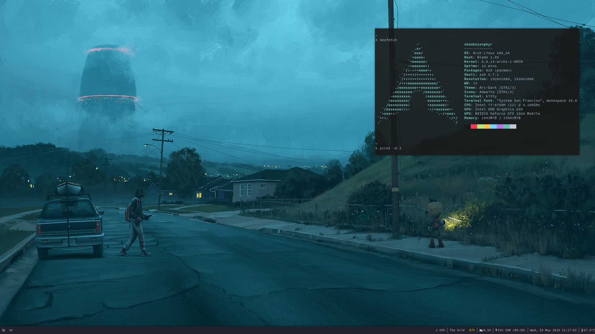

```
     _                 _           __  _       _    __ _ _
 ___| |__   __ _ _ __ | | _____   / /_| | ___ | |_ / _(_) | ___  ___
/ __| '_ \ / _` | '_ \| |/ / __| / / _` |/ _ \| __| |_| | |/ _ \/ __|
\__ \ | | | (_| | | | |   <\__ \/ / (_| | (_) | |_|  _| | |  __/\__ \
|___/_| |_|\__,_|_| |_|_|\_\___/_/ \__,_|\___/ \__|_| |_|_|\___||___/
```

Personal dotfiles, managed with [GNU Stow](https://www.gnu.org/software/stow/).
The core setup is cross-platform; macOS and Linux each add their own layer on top.



## Layout

```
common/   cross-platform stow packages
  nvim/       Neovim - pure Lua, lazy.nvim, LSP via mason, blink.cmp, treesitter
  vim/        classic vim fallback (.vimrc + .vim)
  git/        gitconfig (identity comes from an untracked ~/.gitconfig.local)
  alacritty/  terminal (Iosevka Nerd Font; themes from alacritty-theme submodule)
  starship/   prompt
  mise/       global tool versions (go, node, python, terraform)
  tmux/       terminal multiplexer
  atuin/      shell history
  ssh/        ssh config: work key for github.com, personal key for github-personal
  vscode/     editor settings
mac/      macOS-only packages
  Brewfile    everything installed with Homebrew (not a stow package)
  zsh/        zshrc (antidote, fzf-tab, atuin, zoxide, starship)
  aerospace/  tiling window manager
  karabiner/  keyboard remapping
linux/    stow packages for the Linux box
  i3/ polybar/ dunst/ rofi/ zathura/ kitty/ zsh-legacy/(reference only)
bin/      small utilities
```

## Setup

### 1. SSH keys

The repo is cloned with the personal key through the `github-personal` host,
so create the keys and a minimal ssh config first. The `ssh` package replaces
this config once stowed.

```sh
ssh-keygen -t ed25519 -C "<work email>"     -f ~/.ssh/id_ed25519_work
ssh-keygen -t ed25519 -C "<personal email>" -f ~/.ssh/id_ed25519_personal
printf 'Host github-personal\n  HostName github.com\n  IdentityFile ~/.ssh/id_ed25519_personal\n  IdentitiesOnly yes\n' > ~/.ssh/config
```

Add each `.pub` to its GitHub account, then check: `ssh -T git@github-personal`.

### 2. Clone

```sh
git clone --recurse-submodules git@github-personal:shashankgroovy/dotfiles.git ~/.dotfiles
rm ~/.ssh/config    # stow links the tracked one below
```

### macOS

Install Alacritty first (its cask is disabled), then:

```sh
cd ~/.dotfiles && make mac
```

That runs submodules, `brew bundle` (including Iosevka Nerd Font), stow,
Alacritty's terminfo and `mise install`. Each step is also its own target,
e.g. `make stow-mac`; `make unstow-mac` removes the links.

The Brewfile header lists the apps it can't install. Karabiner needs its
driver and Input Monitoring allowed in System Settings on first launch.

### Linux

```sh
# Arch shown; use your distro's equivalents (mise and antidote may come
# from the AUR / a git clone / https://mise.run)
sudo pacman -S stow neovim starship fzf zoxide atuin direnv \
               eza bat ripgrep lazygit git-delta shellcheck shfmt

cd ~/.dotfiles && make linux    # submodules, Iosevka Nerd Font, stow, mise
```

The zshrc in `linux/zsh-legacy/` predates the current shell setup and is kept
for reference; `mac/zsh/` is the maintained one and works on Linux too - just
point the antidote `source` line at wherever your distro installs it.

### Finish up (both)

```sh
# Machine-local git identity (not tracked); work identity by default
printf '[user]\n\tname = Your Name\n\temail = you@work.com\n' > ~/.gitconfig.local
git -C ~/.dotfiles config user.email "you@personal.com"
```

Re-running `stow` is idempotent; `stow -D` removes a package's links.
First `nvim` launch bootstraps lazy.nvim and installs plugins pinned by
`lazy-lock.json`; language servers arrive via `:Mason`.
To update the Alacritty themes: `git -C ~/.dotfiles submodule update --remote`.
